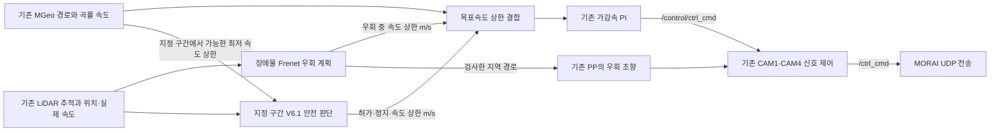

# merge_ws — 기존 주행 + 회전교차로 판단 + LiDAR 장애물 우회

기준 주행은 `jihun_ws`의 `20301b1`이다. 원본 회전교차로 V6.1 판단을 기존 경로
추종·곡률 속도 제어·신호등/정지선 제어에 연결했다. 원본의 독립 차량 제어기는
실행하지 않는다. 최종 차량 명령은 기존 신호 제어기를 거쳐 한 곳에서 발행한다.

장애물 우회는 팀원의 `morai-tunnel-clearance` V1 후보 생성·충돌 검사·여유 거리
계산을 연결했다. 일반 도로와 GPS 음영 모두에서 사용하며 기본 켜짐이다.
회전교차로 기능은 아래처럼 지정 구간이 준비될 때까지 계속 꺼 둔다.

**현재 회전교차로 구간 CSV는 헤더만 있고, 회전교차로 기능은 기본 꺼짐이다.**
일반 커브를 회전교차로로 간주하지 않는다. 사용자가 나중에 시작·끝 구간을
제공하면 그 구간의 정차 위치·진입 충돌 영역·회전 차량 기준 경로를 함께
연결한다. 빈 상태에서 `roundabout on`은 거부한다. 기존 주행 기능은 사용할 수 있다.

기존 보고서·규정 PDF·과거 실험 문서·루트 메모는 이 브랜치의 파일 목록에서
제외했다. 주행 코드, 센서/모델/지도 의존 파일, 테스트와 이 설명만 유지했다.
`final_ws`와 `jihun_ws` 원격 브랜치는 변경하지 않는다.

## 제어 연결



- 회전교차로 진입 전 일회 정차, 순환 차량의 충돌 구간 도착 시간, 잠시 가려진
  차량의 관측 기억, 진입 확정 후 앞차 상대속도 제어는 V6.1 판단을 사용한다.
- 신호등 정차와 회전교차로 정차 중 하나라도 필요하면 정차한다. 회전교차로가
  허가해도 기존 빨간불·회전/경로 제약은 해제되지 않는다.
- 속도 상한은 **기존 PI 전에** 결합한다. 판단 속도는 m/s, 기존 PI 입력은 km/h이며
  한 번만 변환한다. 조향은 기존 Pure Pursuit가 계속 담당한다.
- 회전교차로 노드는 속도·위치·LiDAR와 양쪽 시간의 신선도를 확인한다. 활성 구간에서
  판단 또는 입력이 오래되면 정지한다. `allowed=false`만으로 일반 도로를 멈추지 않는다.
- 경로 파일 SHA-256이 양쪽에서 일치해야 한다. 기존 곡률 계획이 해당 구간에서
  허용하는 속도를 판단 노드에 전달해 도달할 수 없는 속도로 진입을 예측하지 않는다.
  가능한 상한이 최소 합류 속도보다 낮거나 이 정보가 끊기면 진입을 보류한다.
- 차량이 실제로 겹친 상태는 앞차 추종·뒤차 TTC 예외로 무시하지 않는다.
  이 항목은 회전교차로 판단에 대한 설명이다. 장애물 우회 실패 정책은 아래와 같다.

## 주요 파일

| 위치 | 역할 |
| --- | --- |
| `morai_ws/src/bringup/morai_bringup/launch/merge_ws_drive.launch` | 통합 런치, 회전교차로 기본 비활성 |
| `morai_ws/src/mission/roundabout_mission/src/roundabout_mission/` | V6.1 판단, 예측, 관측 기억, 명시적 CSV 구간 로더 |
| `morai_ws/src/mission/roundabout_mission/scripts/merge_ws_roundabout_gate.py` | 기존 토픽을 판단 입력으로 변환하는 노드 |
| `morai_ws/src/control/purepursuit_mgeo/src/purepursuit_mgeo/mission_speed_gate.py` | 판단 메시지 검증, 시간 제한, 속도 상한 결합 |
| `morai_ws/src/experimental/curvature_speed_purepursuit/scripts/curvature_speed_purepursuit_node.py` | 기존 경로·곡률 계획과 PI에 판단을 연결 |
| `morai_ws/src/control/turn_signal_controller/` | 기존 신호·정지선·교차로 진입 제어 |
| `morai_ws/src/control/stopline_control/` | 기존 점진 감속, 앞범퍼 0.5 m 정차 목표 |
| `morai_ws/config/roundabout/regions.csv` | 구간 지정용 CSV, 현재 데이터 행 없음 |
| `morai_ws/config/roundabout/defaults.yaml` | 회전교차로 판단 모델의 거리·시간·속도 설정 |
| `morai_ws/src/control/purepursuit_mgeo/src/purepursuit_mgeo/tunnel_frenet_planner.py` | 팀원 V1 후보·상자 충돌·여유 거리 계산 |
| `morai_ws/src/control/purepursuit_mgeo/src/purepursuit_mgeo/obstacle_avoidance.py` | NORMAL/AVOIDANCE/RETURN과 원본 복귀 정책 |
| `morai_ws/src/control/purepursuit_mgeo/src/purepursuit_mgeo/avoidance_gate.py` | 지역 경로와 속도를 한 메시지로 검증·적용 |
| `morai_ws/src/control/purepursuit_mgeo/scripts/merge_ws_obstacle_planner.py` | 기존 제어기의 위치·실제 속도와 LiDAR를 계획기에 연결 |
| `morai_ws/src/control/purepursuit_mgeo/scripts/merge_ws_obstacle_states.py` | 팀원 상자/속도 안정화, 원본 센서 시각·map 좌표 검증 |
| `morai_ws/config/avoidance/defaults.yaml` | 우회 속도·후보 범위·복귀 정책 설정 |
| `morai_ws/docker/merge_ws/run_merge.sh` | 통합 실행과 별도 PC 설정 관리 |

## 최초 전환과 실행

Ubuntu의 기존 주행 터미널을 `Ctrl+C`로 종료한 후 진행한다. 기존 컨테이너의
주행 프로세스도 종료해 센서 포트와 최종 명령 발행기가 중복되지 않게 한다.

```bash
cd ~/AutoVehicle
git fetch origin
git switch --track origin/merge_ws
cd morai_ws/docker/merge_ws
bash run_merge.sh init
bash run_merge.sh show
```

이미 로컬 브랜치가 있으면 `git switch merge_ws` 후 `git pull --ff-only origin merge_ws`를 쓴다.
`init`은 처음에 기존 `docker/final_ws/highway.env`와 `highway-test.env`가 있으면
IP·LiDAR 포트·장착 위치·속도·조향 설정을 복사한다. 컨테이너 이름은
`morai-merge-ws-net10`으로 분리하고, 회전교차로는 꺼 둔다.
이후 설정은 `docker/merge_ws/highway.env`와 `highway-test.env`에서 관리한다.

기존에 쓰던 이미지로 **별도 컨테이너를 한 번 생성한 뒤**, 정지 상태에서
통합 소스 전체를 설치한다. 이미지에 기존 LiDAR 메시지 패키지가 빌드돼 있어야 한다.

```bash
bash run_merge.sh start
bash run_merge.sh stop
bash run_merge.sh install --config
bash run_merge.sh start
bash run_merge.sh monitor
```

모니터를 종료하고 차량 제어를 시작하려면:

```bash
bash run_merge.sh drive
```

실행기는 호스트/컨테이너의 소스 해시와 기존 명령 발행기를 확인한다.
설치 목록에는 새 판단 패키지, 새 PI 연결 모듈, LiDAR 추적 소스, 설정 CSV와
통합 런치까지 포함한다. 새 Python 패키지는 기존 이미지에서도 원본 소스로
실행할 수 있도록 구성했다. 새 이미지를 만들 때에는 이 브랜치의 Dockerfile과
catkin 설정으로 함께 빌드한다. `build`를 쓸 경우 설정의 `IMAGE_NAME`을
`morai-final:merge-ws` 등 새 태그로 지정해 기존 이미지 태그와 분리한다.

| 작업 | 명령 |
| --- | --- |
| 설정/실행 런치 확인 | `bash run_merge.sh show` |
| 최고속도 저장 | `bash run_merge.sh speed 35` |
| 기존 점진 정지 접근 설정 | `bash run_merge.sh approach smooth` |
| 기존 CAM1 잔차 조향 보정 | `bash run_merge.sh lane on` 또는 `off` |
| 통신·제어 진단 | `bash run_merge.sh diagnose` |
| CSV 형식·좌표 관계 검사 | `bash run_merge.sh validate` |
| 회전교차로 비활성 | `bash run_merge.sh roundabout off` |
| CSV 준비 후 활성 | `bash run_merge.sh roundabout on` |
| 장애물 우회 활성/비활성 | `bash run_merge.sh avoidance on` 또는 `off` |
| 원본과 같은 우회 실패 정책 | `bash run_merge.sh avoidance-policy reference` |
| 우회 실패 시 정지하도록 변경 | `bash run_merge.sh avoidance-policy stop` |

설정 변경은 launch를 종료하고 다시 실행해야 적용된다. CSV·참조 경로·소스를
변경했으면 컨테이너를 정지하고 `install --config`도 다시 실행한다.

## 장애물 우회 동작과 원본 유지 범위

사용자의 요청대로 **공간 부족만으로 정지하는 새 정책을 기본으로 넣지 않았다.**
원본처럼 최대 ±6 m의 34개 횡방향 후보와 2/3/4초 전환을 비교한다. NORMAL에서는
기존 곡률 속도를 그대로 쓰고, 우회·복귀 중에는 6 m/s(21.6 km/h)를 상한으로
기존 곡률·회전교차로 상한과 결합한다. 일반 직선 전체를 21.6 km/h로 제한하지 않는다.
기존 최고속도, 실제 차량 속도 사용, 점진 정지선 접근, CAM4 신호 모델은 유지한다.

**후보가 모두 실패하면 기본 `reference` 정책은 장애물이 있는 지도 경로를 계속
따라간다. 이 동작은 원본과 같고 충돌 회피나 장애물 앞 정지를 보장하지 않는다.**
상태에는 `reference_fallback=true`와 `no_collision_free_candidate`가 표시된다.
이를 정지로 바꾸고 싶을 때만 위의 `avoidance-policy stop`을 사용한다. ±6 m는
탐색 후보 범위이며 주행 가능 도로나 차선 경계라는 뜻은 아니다. 실제 검출된 벽과
물체의 상자는 검사하지만 지도 차선 바깥이나 미검출 공간까지 안전하다고 증명하지 않는다.

원본에서 가져온 동작:

- 도로에서는 경로 이탈 비용 100, 안전 거리 비용 4를 사용한다.
- 변환 GPS `/localization/gps`의 **새 센서 시각**이 1초간 끊기면 GPS 음영 비용
  (이탈 5, 안전 거리 40, 1 m 선호 여유 부족 비용 100, 완료 지연 비용 10)을 쓴다.
  GPS가 1초간 연속 회복되면 도로 비용으로 돌아간다. 실제 지리적 터널 판별은 아니다.
- 음영에서 경로를 막았던 물체만 최대 1.5초 기억한다. 빈 프레임이 기억 시간을
  늘리지 않는다. 검사에 통과한 기존 경로는 유지하고 재계획 때 횡속도·횡가속도와
  완료 지점을 이어 써 매번 횡이동을 처음부터 시작하는 것을 줄인다.
- 매 후보에 물체·벽의 회전 상자 충돌 검사를 적용한다. 원본의 불확실한 상자
  방향 처리와 긴 벽 상자의 방향 안정화도 사용한다.

현재 주행과 맞춘 연결:

- LiDAR UDP 수신/추적기는 **한 개**이며 회전교차로와 공유한다. 기존 IP·포트·장착값을
  그대로 전달한다. 별도 원본 설치 스크립트나 차량 명령 발행기는 실행하지 않는다.
- 기존 제어기가 확인한 위치·실제 차량 속도·경로 진행 위치를 계획기에 전달한다.
  교차하거나 가까운 반대편 도로를 전역 최근접 검색으로 잘못 고르지 않게 한다.
  폐경로 끝에서는 앞부분 경로를 이어 계획하므로 회차 시 목표 끝으로 정차하지 않는다.
- 우회 경로와 속도를 한 메시지로 적용한다. 우회 중 CAM1 차선 중앙 보정은 해제하고,
  조향 크기·변화율 제한은 기존 제어기에 둔다. 빨간불·정지선·회전교차로 정지는 계속 적용된다.
- 원본 시험 런치의 횡가속도 100 m/s²·곡률 3 1/m 대신 현재 차량 조향 한계와 저장된
  회전 횡가속도 제한을 사용한다. 차량 앞부분 위치도 기존 앞범퍼 기준값에 맞춘다.
  일반 도로의 이동 물체를 위해 기본 `assume_static_obstacles=false`로 두었다.
  고정 장애물만 있는 시험 장면이라면 설정 파일에서 true로 바꿀 수 있다.
- LiDAR·위치·실제 속도가 끊기거나 계획 결과가 0.8초 넘게 오래되면 정지한다.
  이는 **유효 입력으로 계산했지만 후보가 없는 경우의 reference 복귀**와 구분한다.
  두 시간 기준, 반복 센서 시각, 잘못된 좌표·단위·경로 해시, 순간 위치 이동을 확인한다.

팀원 저장소에는 카메라 장애물 모델·객체 토픽 융합 소스가 없다. 따라서 이 통합의
장애물 형상 입력은 LiDAR이고, 기존 카메라는 차선·정지선·신호등을 담당한다.
카메라로 장애물 종류를 판별하는 추가 코드가 있다면 해당 소스와 토픽 계약을 받아
연결해야 한다. 새로운 모델이나 카메라 보정을 임의로 만들지는 않았다.

상태는 컨테이너에서 다음처럼 확인한다.

```bash
rostopic echo /planning/avoidance/decision
```

`state`, `decision_reason`, `tunnel_mode`, `candidate_offset_m`, `candidate_clearance_m`,
`reference_fallback`, `held_obstacles`를 확인한다. 속도는 m/s, 경로는 map 좌표다.
새 센서 수신을 위한 시뮬레이터 설정 변경은 없으며 기존 LiDAR 송신 설정이 필요하다.

## 나중에 지정할 회전교차로 구간

`regions.csv`에는 **시작·끝의 임의 값이나 원본 팀의 인덱스를 넣지 않았다.**
인덱스는 `data/routes/2026_molit_comp_global_path.txt`를 읽은 원본 경로점의
0부터 시작하는 순번이다. 중복 경로점을 제거한 제어기 내부 순번과 구분한다.

현재 로더의 열은 다음과 같다.

```csv
region_id,start_index,end_index,stop_pose_index,entry_index,conflict_start_index,conflict_end_index,merge_complete_index,circulating_path_file,circulating_conflict_start_index,circulating_conflict_end_index
```

사용자가 시작·끝 CSV를 제공하면 나머지 판단 위치와 대응시킨다. 시작은 감속을
준비할 지점이고 끝은 이 판단을 해제할 지점이다. `stop_pose_index`는 물리적
정지선이 아니라 **자차 위치 기준점이 정차할 경로점**이다. 물리적 양보선에서
앞범퍼 여유를 계산해 정해야 한다. 충돌 구간은 자차 경로와 순환 차량 경로에서
같은 물리 영역을 뜻해야 한다. 안전 판단에 필요한 값이 누락되거나 순서가
뒤집히거나 구간이 겹치면 활성화를 거부한다.

원본의 `/root/roundabout_circulating.csv`도 저장소에 없으므로 임의로 만들지 않았다.
나중에 순환 차량 경로를 준비하면 `config/roundabout/` 아래에 넣고 CSV에 상대
경로를 기록한다. 이 디렉터리 아래 참조 경로도 설치·해시 확인에 함께 포함된다.
시작·끝만으로 합류 충돌 영역이나 차량 진행 방향을 추정해 켜지는 동작은 없다.

원본에 고정된 1792번 정차점은 CSV의 정차 지점으로, 1840/1860번 출구 감속은
설정된 합류 완료점~구간 끝으로 바꿨다. 기존 실제 속도 토픽 `/Ego_topic`,
`/localization/odometry`, `/perception/lidar/tracked_obstacles_map`을 공유한다.
LiDAR 포트·장착 x/y/yaw는 복사한 기존 설정을 통합 런치로 전달한다.

## 상태 확인

```bash
bash run_merge.sh shell
rostopic echo /planning/roundabout/status
```

`active`, `state`, `stop_required`, `decision_reason`, `target_speed`, `region_id`,
`commit_latched`, `odom_fresh`, `obstacle_fresh`를 확인한다. 판단 노드의 목표속도는
m/s다. `/planning/roundabout/path_capability`는 기존 경로 계획의 구간별 속도 상한이다.
회전교차로가 꺼져 있으면 판단 노드와 이 두 토픽은 실행하지 않는다.
기존 카메라 웹 화면은 Ubuntu의 `http://127.0.0.1:8765`를 사용한다.

## 확인 범위

ROS·UDP를 모의한 검사와 실제 제어 계산 코드로 다음을 확인했다.

- 회전교차로/CSV/노드/시간·단위·설치 계약 28개
- 기존 곡률 및 실제 PI 연결 37개
- 기존 정지선 59개, 교차로·신호 통합 210개
- LiDAR 50개, 저장된 접근 설정 전달 4개

총 388개가 통과했다. 빈 CSV, 일반 커브 비활성, 위험 차량 진입 보류,
일회 정차 후 빈 갭 허가, 실제 겹침, 판단 지연, ID 변경과 속도 상한 전달을
포함한다. 실제 ROS Noetic/catkin 빌드와 MORAI 주행은 이 환경에서 실행하지
못했다. 활성 구간의 실차 응답·시야·제동 보정은 구간 데이터가 준비된 뒤 확인해야 한다.

장애물 통합 추가 확인: 원본 수치 사례 9개, 우회 엔진·경로 메시지·런치 계약
19개, 실제 계획 노드의 모의 ROS 경계 9개가 통과했다. 기존 Pure Pursuit의 실제
콜백 확인 과정에서 기본 토픽을 통합 런치와 맞추는 검사 설정을 보완했다.
이 수치들은 오프라인 계산 범위이며 MORAI에서 장애물 회피 성능을 측정한 결과가 아니다.

원본과 수정 범위는 `THIRD_PARTY_NOTICES.md`에 기록했다.
